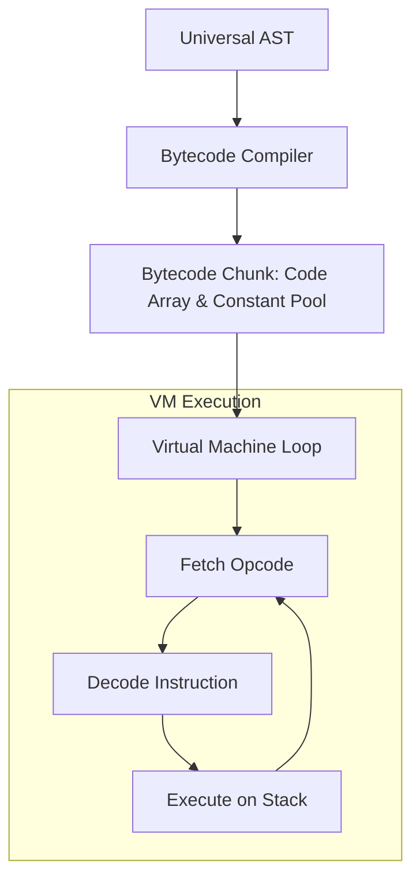

# Bytecode Compiler & Virtual Machine (VM)

Untuk mencapai performa komputasi yang tinggi tanpa mengorbankan fleksibilitas semantik dinamis, Celang mengimplementasikan mesin eksekusi ganda: **Tree-Walking AST Evaluator** (untuk fleksibilitas REPL dan introspeksi interaktif) dan **Stack-based Bytecode Virtual Machine** (untuk kecepatan eksekusi tinggi dan optimasi memori).

---

## 1. Mengapa Bytecode VM?

Pada evaluator Tree-Walking klasik:
- Setiap evaluasi simpul AST melibatkan pemanggilan fungsi rekursif Go yang dalam.
- Alokasi objek intermediate di heap Go menciptakan tekanan pada Garbage Collector (GC).
- Penelusuran pohon acak di memori memicu *cache misses* pada level CPU.

Dengan arsitektur Bytecode VM:
- Pohon U-AST dikompilasi terlebih dahulu ke dalam deretan instruksi linear (*compact byte stream*).
- Operasi dijalankan pada *evaluation stack* berbasis array yang ramah *CPU L1/L2 cache*.
- Alur kontrol (`jika`, `selama`, `untuk`) diubah menjadi instruksi lompatan (*Jump Instructions*) berbiaya sangat rendah.



---

## 2. Struktur Instruksi & Opcode

Kompiler Celang memancarkan instruksi yang didefinisikan dalam [`pkg/bytecode/opcode.go`](file:///home/yosatsu/Coding/Celang/pkg/bytecode/opcode.go):

| Kelompok Opcode | Contoh Opcode | Fungsi |
| :--- | :--- | :--- |
| **Konstanta & Literal** | `OpConstant`, `OpTrue`, `OpFalse`, `OpNull` | Mendorong nilai literal ke puncak *stack*. |
| **Aritmatika** | `OpAdd`, `OpSub`, `OpMul`, `OpDiv`, `OpMod` | Mengambil 2 operand teratas, menghitung, dan mendorong hasil. |
| **Perbandingan** | `OpEqual`, `OpNotEqual`, `OpGreaterThan`, `OpLessThan` | Evaluasi boolean kondisi pembanding. |
| **Manipulasi Stack** | `OpPop` | Membuang nilai yang tidak lagi diperlukan dari stack. |
| **Variabel Global/Lokal** | `OpSetGlobal`, `OpGetGlobal`, `OpSetLocal`, `OpGetLocal` | Membaca/menulis variabel pada indeks memori cepat. |
| **Alur Kontrol** | `OpJumpNotTruthy`, `OpJump` | Melompati instruksi berdasarkan kondisi logika (*branching*). |
| **Koleksi & Indeks** | `OpArray`, `OpMap`, `OpIndex` | Membangun array, map, serta mengakses indeks/kunci. |
| **Fungsi & Frame** | `OpCall`, `OpReturnValue`, `OpReturn` | Mengelola *CallFrames* dan lingkup variabel lokal. |
| **I/O Cepat** | `OpPrint` | Mencetak nilai dari stack secara langsung tanpa overhead wrapper. |

---

## 3. Desain Stack-Based Virtual Machine

Mesin virtual Celang (`pkg/vm/vm.go`) beroperasi menggunakan model *stack-based*:

```
          ┌──────────────┐
  Top ──► │      25      │  ◄── Puncak Stack
          ├──────────────┤
          │      10      │
          ├──────────────┤
          │ "Halo Celang"│
  Base ─► └──────────────┘
```

Ketika instruksi `OpAdd` dijalankan:
1. Angka `25` di-pop dari puncak stack.
2. Angka `10` di-pop dari stack.
3. Hasil penjumlahan (`35`) didorong (*push*) kembali ke puncak stack.

### Manajemen Bingkai Panggilan (*Call Frames*)

Saat fungsi dipanggil:
- VM mengalokasikan bingkai panggilan (*CallFrame*) baru yang mencatat *Instruction Pointer* (IP) fungsi pemanggil dan penunjuk dasar stack (*base pointer*).
- Setelah fungsi selesai mengembalikan nilai (`OpReturnValue`), CallFrame dilepaskan dan eksekusi melompat kembali ke instruksi berikutnya di fungsi pemanggil secara instan.

---

## 4. Cara Menjalankan Mode Bytecode VM

Secara default, `celang run` menjalankan program menggunakan runtime AST. Anda dapat mengaktifkan akselerasi Bytecode VM dengan menyematkan bendera `--vm`:

```bash
# Menjalankan program menggunakan Bytecode Virtual Machine
celang run --vm program.ce

# Mengukur waktu eksekusi untuk benchmarking
time celang run --vm program.ce
```

---

## 5. Ringkasan Perbandingan Evaluator

| Karakteristik | AST Evaluator | Bytecode VM (`--vm`) |
| :--- | :--- | :--- |
| **Model Eksekusi** | Tree-Walking rekursif | Linear Bytecode Loop |
| **Penggunaan Memori** | Lebih tinggi (banyak simpul node) | Sangat hemat (deretan byte & array) |
| **Kecepatan Aritmatika & Loop** | Standar | Hingga 2-5x lebih cepat |
| **Dukungan REPL Interaktif** | Utama | Terintegrasi |
| **Portabilitas Bytecode** | Perlu pohon JSON | Dapat diekspor ke binary chunk |
