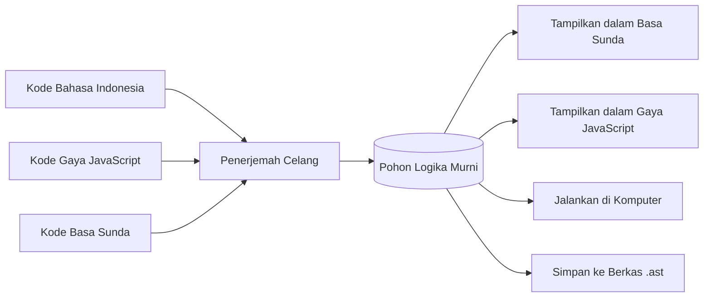

# Pohon Sintaks Universal (Universal AST / U-AST)

Pernahkah Anda memikirkan sebuah ide, lalu Anda bisa menceritakan ide tersebut dalam Bahasa Indonesia, Bahasa Inggris, atau Bahasa Sunda? 

Idenya tetap sama, yang berganti hanyalah kata-kata yang keluar dari mulut Anda.

Itulah cara kerja **Universal Abstract Syntax Tree (U-AST)** atau **Pohon Logika Murni** di Celang.

---

## 1. Ide Pikiran vs Kata-Kata yang Terlihat

Di kebanyakan bahasa pemrograman konvensional, teks tulisan dan logika program menempel secara kaku. Jika Anda mengubah kata kuncinya, komputernya langsung bingung.

Celang memisahkan keduanya:
- **Pohon Logika (U-AST)** ibarat **isi pikiran murni** dari program Anda.
- **Teks Kode (.ce)** ibarat **pakaian atau bahasa** yang digunakan untuk membaca pikiran tersebut ke mata manusia.



### Apa Manfaatnya bagi Pengguna?
1. **Tidak Ada Perdebatan Format**: Jika rekan kerja Anda lebih suka gaya JavaScript dan Anda lebih suka Bahasa Indonesia, Anda berdua bisa melihat logika yang sama persis sesuai kenyamanan mata masing-masing.
2. **Kekebalan dari Kesalahan Ejaan**: Karena yang disimpan dan dijalankan adalah inti logikanya, mengganti tampilan tidak akan merusak alur perhitungan program.
3. **Bisa Disimpan sebagai Data**: Seluruh pohon logika ini dapat disimpan ke berkas data berekstensi `.ast` dan dijalankan langsung kapan saja.

---

## 2. Mengenal Bagian-Bagian dalam Pohon Logika

Di dalam ingatan komputer, program Anda disusun seperti dahan pohon keluarga yang rapi:

1. **Pernyataan Tindakan**: Perintah yang melakukan sesuatu tetapi tidak menghasilkan nilai balasan langsung.
   - Membuat wadah nilai baru (`buat nama = "Budi"`).
   - Mengambil keputusan (`jika nilai > 75 ...`).
   - Melakukan pengulangan (`untuk orang dalam sahabat ...`).
2. **Ungkapan Nilai**: Bagian yang menghasilkan sebuah jawaban atau angka.
   - Perhitungan hitungan (`10 + 20`).
   - Pengambilan keputusan ya/tidak (`umur >= 17`).
   - Pemanggilan tindakan (`cetak("Halo")`).

---

## 3. Menyimpan dan Menjalankan Berkas Logika (.ast)

Selain berkas teks biasa (`.ce`), Celang dapat mengubah program Anda langsung menjadi berkas data logika berformat JSON (`.ast`):

```bash
# Mengubah berkas kode menjadi berkas data logika:
./celang compile program.ce -o program.ast
```

Berkas `.ast` yang dihasilkan berisi catatan struktur logika murni. Anda dapat menjalankannya langsung di terminal:

```bash
./celang run program.ast
```

Karena formatnya adalah data biasa, alat bantu lain seperti editor kode, pemeriksa otomatis, atau kecerdasan buatan dapat membaca dan memahami program Anda dengan sangat mudah tanpa harus meraba-raba teks mentah dari awal.
