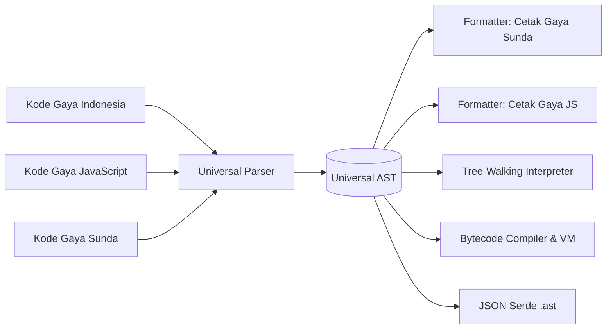

# Universal AST (U-AST) & JSON Serde

Salah satu pilar arsitektur utama Celang adalah **Universal Abstract Syntax Tree (U-AST)**. Alih-alih mengikat pohon sintaksis secara erat dengan kata kunci gramatikal tertentu, Celang merepresentasikan seluruh konstruksi kode ke dalam struktur semantik universal yang independen dari gaya bahasa (*syntax-agnostic*).

---

## 1. Konsep & Filosofi

Dalam kebanyakan kompiler tradisional:
```
Kode Sumber (Go/Python) ──► AST Spesifik Bahasa ──► Bytecode / Machine Code
```

Dalam Celang:


Karena pohon semantiknya bersifat universal:
1. Kode dari dialek apa pun menghasilkan U-AST yang identik.
2. Formatter dapat mencetak U-AST kembali ke dialek mana pun tanpa mengubah makna program.
3. Seluruh pohon U-AST dapat disimpan ke berkas JSON (`.ast`) dan dijalankan ulang kapan saja.

---

## 2. Struktur Node U-AST

U-AST dibangun di atas paket Go [`pkg/uast`](file:///home/yosatsu/Coding/Celang/pkg/uast).

### Hierarki Dasar

- **`Program`**: Simpul akar yang memuat deretan `Statements`.
- **`Statement`**: Pernyataan eksekutif yang tidak mengembalikan nilai secara langsung:
  - `VarDeclStatement`: Deklarasi variabel (`buat x = 10` / `let x = 10`)
  - `ConstDeclStatement`: Deklarasi konstanta
  - `FunctionDeclaration`: Deklarasi fungsi bernama
  - `StructDeclaration`: Deklarasi bentuk / struktur data
  - `IfStatement`: Percabangan kondisi
  - `WhileStatement` & `ForStatement`: Perulangan
  - `ConcurrencyStatement`: Blok `sambil` / `bersamaan`
  - `TimeTravelStatement`: Blok perjalanan waktu `mundur ke ...`
- **`Expression`**: Konstruksi ekspresi yang menghasilkan nilai:
  - `BinaryExpression`: Operasi biner (`+`, `-`, `*`, `==`)
  - `PipelineExpression`: Operasi pipa (`|>`)
  - `CallExpression`: Pemanggilan fungsi / metode
  - `DestructureAssignment`: Destrukturisasi array atau kamus

---

## 3. Serialisasi & Deserialisasi JSON (Serde)

U-AST memiliki dukungan bawaan untuk serialisasi dua arah (*bidirectional JSON serde*).

### Mengekspor U-AST ke JSON

Anda dapat mengintrospeksi pohon AST menggunakan perintah baris Celang:

```bash
# Menghasilkan berkas pohon sintaksis program.ast
celang parse program.ce -o program.ast
```

Contoh cuplikan dokumen JSON AST untuk deklarasi variabel:

```json
{
  "type": "VarDeclStatement",
  "name": "saldo",
  "value": {
    "type": "IntegerLiteral",
    "value": 1500000
  },
  "metadata": {
    "line": 4,
    "column": 1
  }
}
```

### Menjalankan Berkas U-AST Langsung

Celang dapat mengeksekusi berkas `.ast` secara langsung tanpa melalui tahap lexing dan parsing ulang:

```bash
celang run program.ast
```

Fitur ini membuka peluang integrasi ekosistem yang luar biasa: IDE, static analyzer, AI code generator, atau linter pihak ketiga dapat memanipulasi AST berupa file JSON biasa tanpa perlu menulis parser bahasa dari nol!
