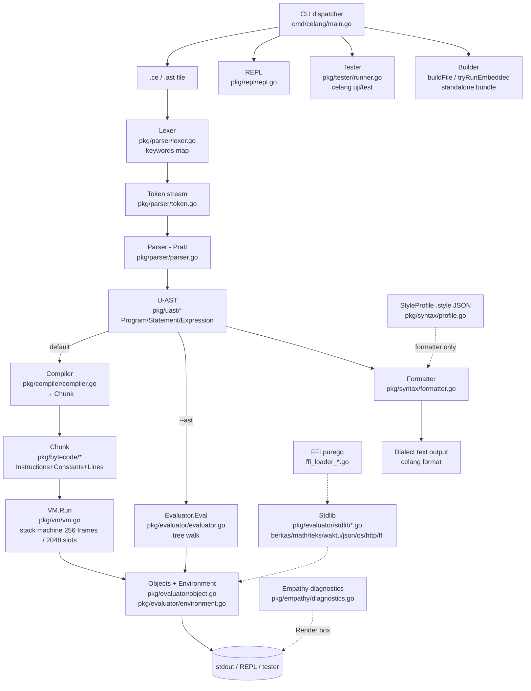

# Architecture — Celang

## System Map

```
source .ce  ──►  Lexer  ──►  Parser (Pratt)  ──►  U-AST  ─┬─►  Compiler  ──►  Chunk  ──►  VM  ──► result
               (lexer.go)    (parser.go)      (uast/*)  │     (compiler.go)   (bytecode/*) (vm.go)
                                                         └─►  Evaluator ───────────────► result
                                                               (evaluator.go)                  ▲
                                                                    │                          │
                                           Syntax Profile ──────────┘                          │
                                           (profile.go/formatter.go)  ──►  CLI/REPL/Tester ──┘
                                           .style JSON                 (cmd/celang, pkg/repl, pkg/tester)
```

Key insight verified in code: `pkg/syntax` is **not** used by lexing or parsing. The lexer holds a single global `keywords` map containing every dialect at once (`pkg/parser/lexer.go:8-164` — Indonesian, English, Jawa). Dialects are an output projection: the `Formatter` renders a U-AST back to text using a `StyleProfile`. There is no per-profile lexing pass.

## Modules and Responsibilities

| Module | Path | Role |
|--------|------|------|
| Token definitions | `pkg/parser/token.go` | `TokenType` constants (`VAR_DECL`, `IF`, `SALURAN`, `TITIP`, etc.). Shared vocabulary for lexer and parser. |
| Lexer | `pkg/parser/lexer.go` (575 LOC) | `Lexer{input, position, ch, line, column, IsUniversal}`. `NextToken()` scans one token, handling strings with `${...}` interpolation holes, numbers, two-word compounds (`selain jika`, `kalau kosong`), operators (`|>`, `=>`, `?.`, `??`). `keywords` map is the single source of truth for all dialects. |
| Universal mode gate | `pkg/parser/universal.go` (85 LOC) | `DetectUniversalDirective(source)` scans past blank/comment lines; `"use universal"` / `"use english"` / `"use standard"` toggles `IsUniversal`. When set, `culture_helpers.go` blocks Indonesian natural-language suffixes. |
| Parser | `pkg/parser/parser.go` (~2743 LOC) | Pratt parser. `Parser{l, curToken, peekToken, prefixFns, infixFns, parenDepth, IsUniversal, errors}`. `ParseProgram() (*uast.Program, error)` loops `parseStatement` until `EOF`. Precedence ladder: `LOWEST < PIPELINE \|\> < COALESCE \?\? < OR < AND < RANGE .. < EQUALS < LESSGREATER < SUM < PRODUCT < PREFIX < CALL < INDEX`. Collected errors returned as `ParseErrorList`. |
| U-AST nodes | `pkg/uast/{node,program,statement,expression,serde}.go` | Dialect-free tree. `NodeType` enum (~40 values), `Program{Version, Body []Statement, IsUniversal}`, `Position`/`NodeMetadata`, statement types (`VariableDeclaration`, `IfStatement`, `ForEachStatement`, `StructDeclaration`, `StyleBlockStatement`, `TestStatement`, ...), expression types (`Literal`, `BinaryExpression`, `CallExpression`, `PipelineExpression`, `TitipExpression`, ...), JSON helpers `ToJSON`/`FromJSON`/`UnmarshalStatementJSON`. |
| Syntax profiles | `pkg/syntax/profile.go` (473 LOC) | `StyleProfile{ Name, DisplayName, fields VarDecl/If/For/Func/True/BlockStyle/IndentWidth/QuoteStyle, ... }`. `UnmarshalJSON` handles flat and categorized (per-bab) shapes (`deklarasi`, `percabangan`, `format`, ...). Examples: `examples/jawa.style`, tests in `profile_test.go`. |
| Formatter | `pkg/syntax/formatter.go` (956 LOC) | `Formatter{profile}` — the reverse parser. `Format(program)` walks U-AST and emits text using profile keywords, `BlockStyle` (brace vs indent), and `QuoteStyle`. This is the `celang format --style=...` engine. |
| Bytecode | `pkg/bytecode/{opcode,chunk,function}.go` | `Opcode byte` enum (40 ops), `Chunk{Instructions []byte, Constants []Object, Lines []int}` with `WriteOp`/`WriteUint16`/`AddConstant`/`Disassemble`, `CompiledFunction{Name, Chunk, NumParams}` and `globalVMRunner` hook. |
| Compiler | `pkg/compiler/compiler.go` (1027 LOC) | `Compiler{chunk, locals []Local{Name,Depth,IsMutable}, scopeDepth, loopStack, env}`. `Compile(program) (*Chunk, error)` and per-node `compileStatement`/`compileExpression`. Locals are stack slots; globals are in `Chunk.Constants`; `OpDefineGlobal`/`OpGetGlobal`/`OpGetLocal`/`OpSetLocal`. `emitJump`/`patchJump`/`emitLoop`/`OpForIter` handle control flow. Unsupported nodes fall back to `OpEvalAST` (evaluator callback). |
| VM | `pkg/vm/vm.go` (1102 LOC) | Stack machine. `VM{ frames[256]CallFrame{fn,ip,basePointer}, frameCount, stack[2048]Object, sp, globals, env }`. `Run() (Object,error)` dispatch loop over `Instructions[ip++]`. Truth via `CoerceToBoolean`; arithmetic via `evalAdd`/`evalSub`...; `callValue` dispatches `*Function`, `*Builtin`, `*CompiledFunction`; `evalIndex`/`evalSetIndex` handle `[]`, `{}`, `String`, `Bytes`, `Map`; iterator `OpGetIter`/`OpForIter`. |
| Evaluator | `pkg/evaluator/evaluator.go` (2671 LOC) | Tree-walk alternative. `Eval(node, env) Object` type-switch. Also hosts `evalBinaryOp`/`evalUnaryOp`, `ApplyFunction`/`applyFunctionWithGenerics`, `evalMemberAccess` (dot + time-travel + `rujuk` deref + culture suffixes), range/slice, `evalTestStatement`. Errors returned as `*Error` with `Pos`+`FriendlyHint`. |
| Objects | `pkg/evaluator/object.go` (~460 LOC) | `Object` interface (`Type ObjectType, Inspect() string`), types: `Integer(64)`, `Float(64)`, `Boolean`, `String`, `Bytes`, `Null`, `ReturnValue`, `Error`/`AssertionError`, `Function`, `Builtin`, `Array`, `Map`, `Pointer(rujuk)`, `StructDef`/`StructInstance`, `Ticket`, `Channel(saluran)`, `Iterator`, signals (`ROLLBACK_SIGNAL`, `BREAK_SIGNAL`). `Callable` interface for `Call`. |
| Environment | `pkg/evaluator/environment.go` (~500 LOC) | `Environment{store map[string]*VariableEntry{Value,IsMutable,Position,Visibility,History}, outer *Environment, FilePath, ModuleRoot, Registry, IsUniversal}`. `VariableEntry` holds bounded ring history (`DefaultHistoryCapacity=50`). Methods: `Define`/`DefineWithVisibility`/`SetVisibility`/`Get`/`Assign` (transaction savepoint + reactivity), `Begin/Commit/RollbackTransaction`, `DefineReactive`/`triggerReactivity`, `PushDefer`/`PopAllDefers`, type-alias and reference tables, thread-safe with `sync.RWMutex`/`atomic`. |
| Coercion | `pkg/evaluator/coercion.go` | `CoerceToNumeric(Object) (int64,float64,bool,bool)` with `numericRegex`; `CoerceToBoolean`, smart string-to-number extraction (`"Rp 150000" - 25000`). |
| Collections | `pkg/evaluator/collections.go` + `culture_helpers.go` | `ObjectsEqual` (cycle-aware), `evalAdd` length semantics, `Bita` helpers, natural sort `sortNatural`, and `culture_helpers.go` numeric member access with suffix multipliers (`ribu`*1k ... `triliun`*1T, `usd`, `kb/mb`, `ms/detik/menit/jam/hari`) — gated by `IsUniversal`. |
| Concurrency | `pkg/evaluator/concurrency_modern.go` | `Ticket{mu, done chan, result, err, isDone}` + `NewTicket`, `Channel` with `Kirim/Terima/Tutup`, helpers for `titip`/`jemput`/`jemput_semua`/`jemput_pertama`. |
| Builtins | `pkg/evaluator/builtins.go` (500+ LOC) | `RegisterBuiltins(env,out)` / `RegisterBuiltinsWithIO(env,in,out)` installs `cetak`, `masukan`, `panjang`, `tipe`, `rentang`, `saring`, `petakan`, `salin`, `Saluran`, `jemput*`, `terbilang`, clock helpers, etc. Handles `os.Stdin`/`out io.Writer` injection for tests/WASM. |
| Stdlib | `pkg/evaluator/stdlib*.go` + `stdlib.go` | Registry `StdlibNames` (canonical + aliases), `RegisterStdlibGlobals(env)` injecting `berkas`/`fs`, `matematika`/`math`, `teks`/`strings`, `waktu`/`time`, `json`, `sistem`/`os`, `http`/`jaringan`/`net`, `ffi`. Per-module files: `stdlib_berkas.go`, `stdlib_math.go` (incl. `terbilang`), `stdlib_strings.go`, `stdlib_time.go` (hari/bulan Indo), `stdlib_json.go`, `stdlib_system.go` (process/uptime/script args), `stdlib_http.go`. |
| FFI | `pkg/evaluator/stdlib_ffi.go` + `ffi_loader_{unix,windows,wasm}.go` | C ABI dynamic loading: `ffiOpen(path)` / `ffiSymbol(handle,name)` via `purego.Dlopen` (unix), `syscall.LoadLibrary` (windows), error stub (wasm). `FFIPointer{Address uintptr}` with `Read/Write` builtins. |
| Module | `pkg/evaluator/module.go` | `findModuleRoot(filePath)` walks up searching for `celang.mod`/`modul.ce`; otherwise file dir. `LoadModule(path, env)` parses and caches; circular-import guard via `Registry`. |
| Diagnostics | `pkg/empathy/diagnostics.go` (371 LOC) | `Diagnostic{Title,Message,Line,Column,FriendlyHint,SourceCode,OtherErrorsCount,IsUniversal}`. `NewRuntimeDiagnostic(err,src)`, `NewSyntaxDiagnostic(raw,line,col,src)`, `NewSyntaxDiagnosticFromError(err,src)` (handles `ParseErrorList`), `Render() string` renders `╭─` box, `│ N │ code` gutter, `^ di sini`, hint `💡 Saran Solusi:`. |
| CLI | `cmd/celang/main.go` (829 LOC) | `main()`: `tryRunEmbedded()` bundle check → default `repl.Start` if no args → `switch os.Args[1]`. Commands: `bangun`/`build`→`buildFile`, `repl`→`repl.Start`, `run`→`runFile`, `disasm`→`disasmFile`, `compile`/`parse`→`compileFile`, `format`→`formatFile`, `init`→`initProject`, `ast`/`uast`→print tree, `uji`/`test`→`tester.Run`, `versi`/`version`, `help`/`bantuan`. Flags `--ast`/`--vm`/`-w`/`--style`/`--target`/`--runner`. `buildFile` gzips payload + trailer `CELANG_BUNDLE_OK` for standalone binaries. |
| REPL | `pkg/repl/repl.go` (308 LOC) | `Options{Style, In, Out}`, `Start(Options) error`. Reads lines, handles `:keluar`/`exit`, multi-line brace tracking, then lex→parse→compile→VM (or eval) per input, prints result via `Inspect()`. |
| Tester | `pkg/tester/runner.go` (333 LOC) | `FileResult{FilePath, Cases []TestCase{ Name, Passed, Error, Duration }}`, `Run(paths []string, filter string) Summary`. Discovers `uji "name" { harus_sama(...) }` blocks, runs each with timeout, reports colored `✓`/`✕`, summary `SUKSES/GAGAL`. CLI: `celang uji [target...] [-f filter]`. |
| IDE | `editors/vscode/` | `celang.tmLanguage.json`, `snippets/celang.json`, `language-configuration.json`. |
| WASM | `cmd/celang-wasm/main.go` | JS bridge; `ffi_loader_wasm.go` + `stdlib_ffi_wasm.go` stub out native FFI. |

## Data and Control Flow (Runtime)

```
CLI run  →  read file  →  lexer keywords map  →  token stream  →  Pratt parser  →  U-AST Program
                                      │                                    │
                                      │ `IsUniversal` flag ────────────────┘
                                      ▼
                              Environment{store, outer, IsUniversal}
                                      │
                        ┌─────────────┴──────────────┐
                        ▼                            ▼
                    Compiler                     Evaluator.Eval
                  bytecode.Chunk                (tree walk)
                        │                            │
                        └──────────┬─────────────────┘
                                   ▼
                              VM.Run  or  Eval loop
                                   │
                     Object graph (Integer/String/Array/Map/...)
                     + VariableEntry history + defer stack + transaction log
                                   │
                              io.Writer (stdout / REPL out / tester buffer)
```

Scopes: parser builds `BlockStatement` nesting; evaluator creates `NewEnclosedEnvironment(outer)` per block/function; compiler maps locals to VM stack slots `OpGetLocal`/`OpSetLocal` with `scopeDepth` and `locals[]`; globals live in `Chunk.Constants` via `OpDefineGlobal`/`OpGetGlobal`.

## Design Decisions (Evidence-Backed)

1. **All dialects in one lexer**. No profile file is consulted during lexing; every spelling is valid everywhere. Consequence: you cannot have dialect-specific syntax shapes — only keyword spellings. Verified by `lexer.go:keywords` and absence of any `syntax.Profile` import in `pkg/parser/`.

2. **Two executors, one tree**. The VM is default for speed; evaluator is retained for fidelity/debugging (`--ast`). Parity tests exist (`vm/stress_parity_test.go`) but coverage is sampled, not exhaustive. Fallback `OpEvalAST` lets the compiler delegate unsupported nodes to the evaluator, so the VM does not need to be feature-complete to ship.

3. **Bounded history**. `VariableEntry` caps at 50 `History` entries (`environment.go:12`). Reads of `.histori`/`.sebelalu`/`.awal` are O(1) memory; long loops cannot leak.

4. **Bilingual diagnostics via `IsUniversal`**. All empathy branching checks `DetectUniversalDirective(source)` or `env.IsUniversal`; Indonesian strings and English strings are two hard-coded sets in `diagnostics.go` and `culture_helpers.go`.

5. **Build as self-extracting bundle**, not native compilation. `buildFile` writes the runner binary, appends gzipped source + 24-byte trailer (`CELANG_BUNDLE_OK`). `tryRunEmbedded` reverses this. This keeps cross-build simple (`--target`) but is not AOT.

## Mermaid Architecture Diagram


